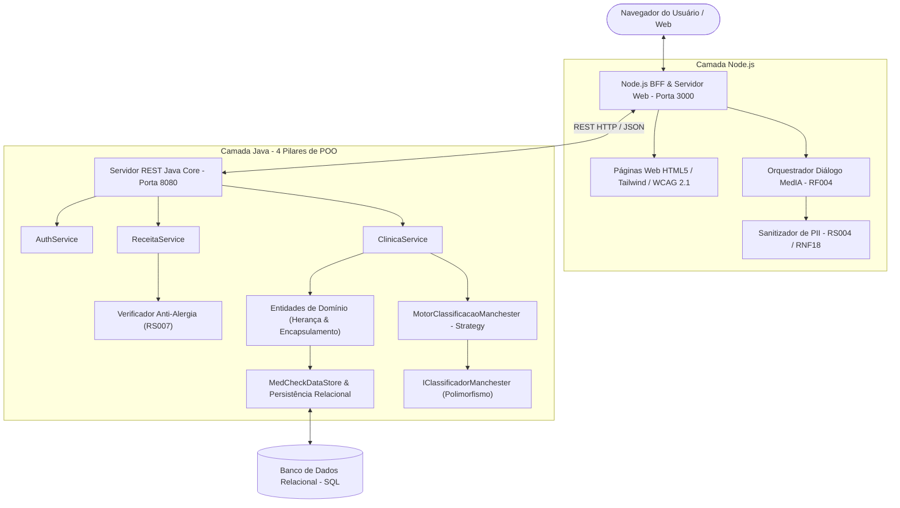

# Arquitetura do Sistema — MEDCHECK (MedIA)
## Projeto Integrado de POO (AV03) & Requisitos Clínicos 2026.2

---

### 1. Visão Geral da Arquitetura
O MEDCHECK é construído em uma arquitetura em camadas combinando **Java 25** no Core de Domínio e Motor Clínico (garantindo excelência na aplicação dos 4 Pilares de Orientação a Objetos) e **Node.js v24** na camada de BFF (Backend for Frontend), Gateway Conversacional com IA e apresentação Web responsiva (WCAG 2.1).

---

### 2. Mapeamento dos 4 Pilares de POO em Java (60% da Avaliação AV03)

| Pilar de POO | Aplicação Concreta no Código Java do MEDCHECK |
| :--- | :--- |
| **1. Abstração** | • Classe abstrata base `Usuario` definindo contratos essenciais e o método abstrato `obterDescricaoPerfil()`. • Subclasse abstrata intermediária `ProfissionalSaude` abstraindo conselhos profissionais. • Interface `IClassificadorManchester` abstraindo a avaliação de árvores clínicas determinísticas. |
| **2. Encapsulamento** | • Todos os atributos das entidades são `private`, com acesso controlado por métodos de negócio. • **Value Object `CPF`**: validação de 11 dígitos, cálculo dos dígitos verificadores e imutabilidade estrita [RS001]. • **Value Object `SinaisVitais`**: métodos semânticos para identificação de gravidade (`isFebreAlta()`, `isDessaturandoCritico()`, `isCriseHipertensiva()`). • **Value Object `ItemReceita`**: encapsula dados posológicos e princípio ativo para prevenção de reações adversas. |
| **3. Herança** | • Hierarquia de Usuários: &nbsp;&nbsp;`Usuario` (abstrato) $\rightarrow$ `Paciente` &nbsp;&nbsp;`Usuario` (abstrato) $\rightarrow$ `ProfissionalSaude` (abstrato) $\rightarrow$ `Medico`, `Enfermeiro`. • Reuso de atributos de auditoria, autenticação e identificação comum a todos os atores do sistema. |
| **4. Polimorfismo** | • **Strategy Pattern do Protocolo de Manchester:** &nbsp;&nbsp;Interface `IClassificadorManchester` com implementações polimórficas: &nbsp;&nbsp;1. `ClassificadorDorToracica` (Protocolo Manchester cardiovascular) &nbsp;&nbsp;2. `ClassificadorDispneia` (Protocolo respiratório/hipóxia) &nbsp;&nbsp;3. `ClassificadorCefaleia` (Protocolo neurológico/meníngeo) &nbsp;&nbsp;4. `ClassificadorGeral` (Fallback clínico) • O `MotorClassificacaoManchester` seleciona e executa a estratégia polimórfica dinamicamente em tempo de execução com base na queixa do paciente. |

---

### 3. Separação Arquitetural entre IA e Motor Clínico [RNF13]
Conforme estipulado no Documento de Requisitos e normas do Conselho Federal de Medicina (CFM):
- A **IA Conversacional** (executada no Node.js) atua exclusivamente como facilitadora de acolhimento e coleta de sintomas em linguagem natural acessível.
- A **Classificação de Risco (Manchester)** e o tempo-alvo são processados de forma 100% determinística pelo motor em Java, garantindo auditabilidade e previsibilidade clínica.
- A IA possui **bloqueio arquitetural absoluto de emissão de receitas ou atestados [RS002 / RNF14]**.

---

### 4. Camada de Persistência e Banco de Dados (10% da Avaliação AV03)
- Esquema relacional estruturado em `database/schema.sql` (12 tabelas normalizadas).
- Dados de inicialização e homologação em `database/seed.sql`.
- Repositório `MedCheckDataStore` com integridade referencial, concorrência segura (`ConcurrentHashMap`) e persistência.
- Trilha de Auditoria imutável [RF032 / RS006] registrando módulo, operação, IP e timestamp de cada transação clínica.
